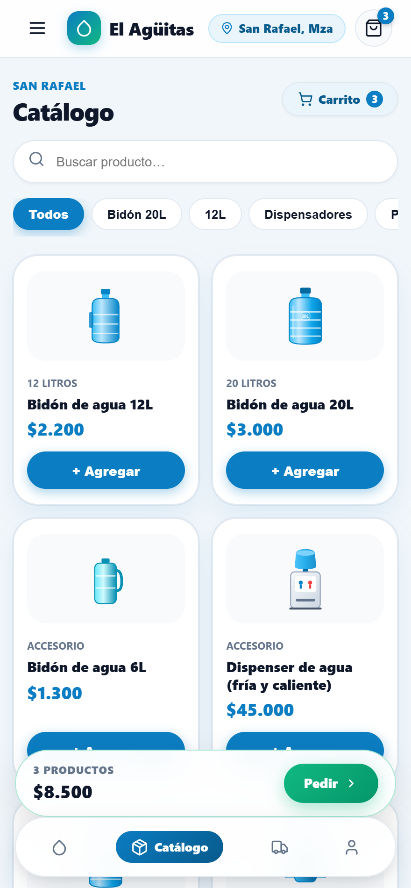
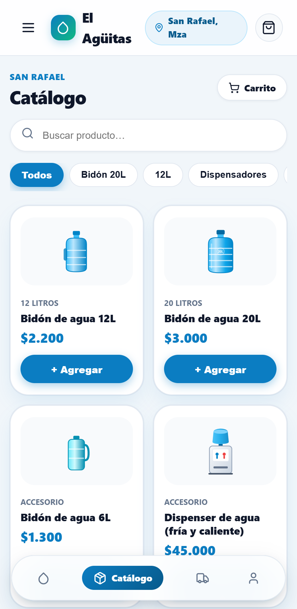
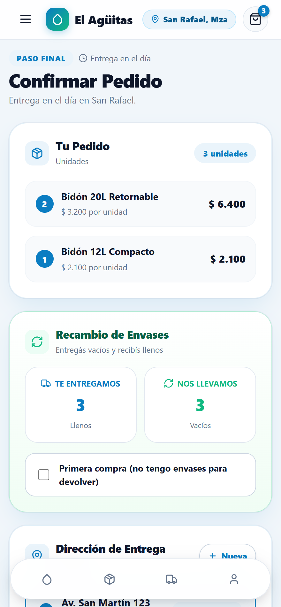
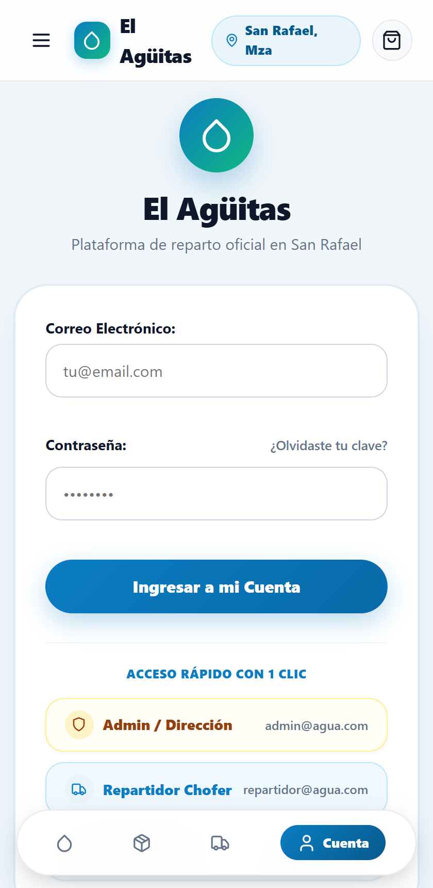
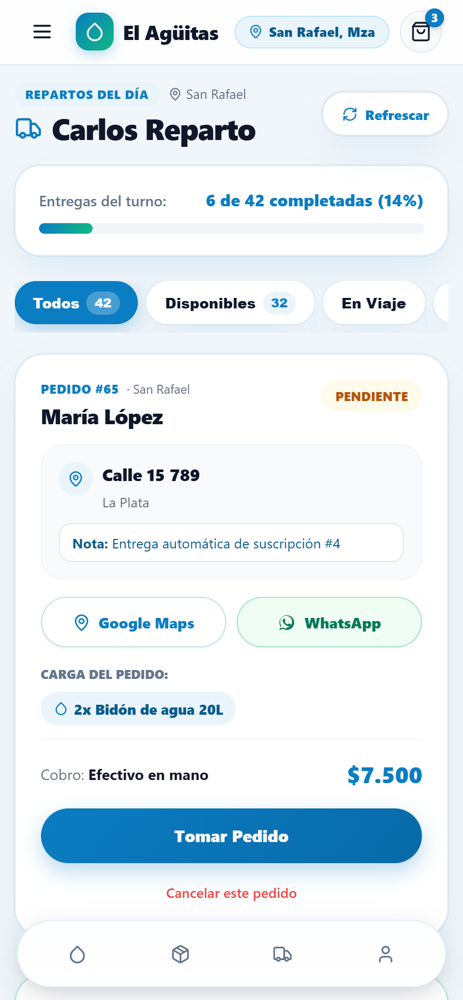
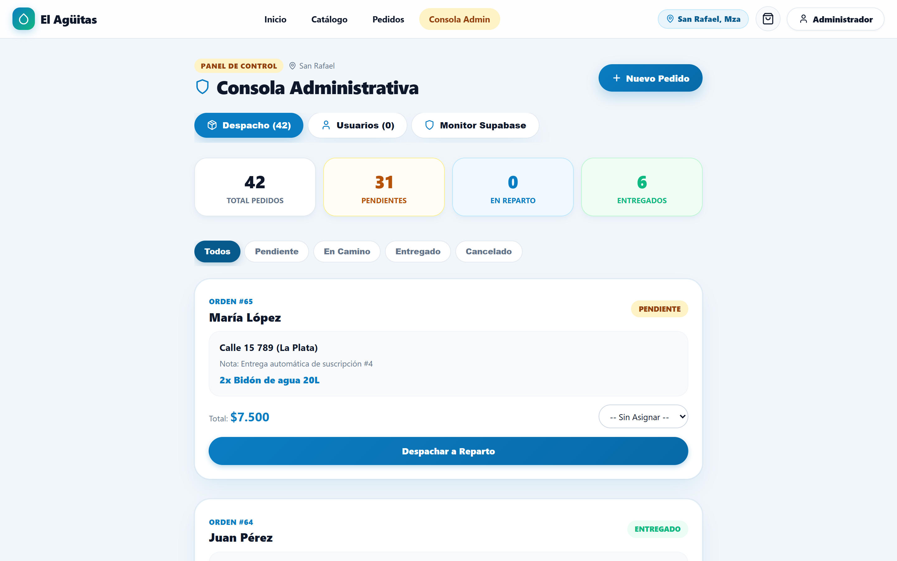

# El Agüitas - Plataforma de Distribución y Logística de Agua

Plataforma fullstack de comercio electrónico y gestión logística para distribuidoras de agua purificada en bidones y dispensers. Diseñada con enfoque **Mobile-First**, integración directa con WhatsApp y Google Maps para repartidores, conciliación contable de envases retornables en tiempo real y arquitectura serverless desplegada en **Vercel** con base de datos **PostgreSQL en Supabase**.

---

## 1. Demostración y Presentación Interactiva

Para reuniones comerciales o pitch de ventas con clientes y distribuidores, el proyecto incluye una suite interactiva de presentación widescreen (16:9) con capturas reales de la aplicación en producción:

- **Presentación en Vivo (Vercel):** `https://<tu-dominio-vercel>.app/presentacion`
- **Presentación Interactiva Local:** [promo-horizontal/presentacion-interactiva.html](promo-horizontal/presentacion-interactiva.html)
- **Video Promocional Horizontal (1080p 60s):** [promo-horizontal/el-aguitas-presentacion-horizontal.mp4](promo-horizontal/el-aguitas-presentacion-horizontal.mp4)

---

## 2. Arquitectura del Sistema

```
                             ┌────────────────────────────────────────────────────────┐
                             │                     CLIENTES / NAVEGADORES            │
                             │   Mobile Web (PWA) • Desktop Dashboard • Android APK   │
                             └───────────────────────────┬────────────────────────────┘
                                                         │ HTTPS
                                                         ▼
                             ┌────────────────────────────────────────────────────────┐
                             │                     VERCEL EDGE NETWORK                │
                             │  • / (SPA React 19 + Vite Static Assets)               │
                             │  • /presentacion (Deck interactivo comercial)          │
                             │  • /api/* (Serverless Functions)                       │
                             └───────────┬────────────────────────────────┬───────────┘
                                         │                                │
                       API Requests      │                                │ Cron Triggers
                      (Auth / Pedidos)   │                                │ (Suscripciones)
                                         ▼                                ▼
                             ┌────────────────────────┐       ┌───────────────────────┐
                             │  VERCEL SERVERLESS FN  │       │  VERCEL CRON WORKER   │
                             │    /api/index.js       │       │ /api/cron/subscript...│
                             │ (Express + JWT + pg)   │       │ (Auto-generador 00:00)│
                             └───────────┬────────────┘       └───────────┬───────────┘
                                         │                                │
                                         │ Pooler Port 6543 (SSL)         │
                                         └────────────────┬───────────────┘
                                                          │
                                                          ▼
                             ┌────────────────────────────────────────────────────────┐
                             │                 SUPABASE POSTGRESQL CLOUD              │
                             │  • 14 Tablas Relacionales (Migraciones 001 - 007)      │
                             │  • Triggers de Trazabilidad y Libro Mayor de Envases   │
                             │  • Control de Sesiones JWT y Encriptación BCrypt       │
                             └────────────────────────────────────────────────────────┘
```

### Componentes de la Arquitectura:

1. **Frontend SPA (React 19 + Vite):**
   - Interfaz táctil ergonómica orientada al pulgar con touch-targets de 48px.
   - Catálogo reactivo en cuadrícula de 2 columnas con selectores de cantidad inmediatos (`-`, `+`).
   - Carrito de compras flotante y flujo de checkout con declaración automática de envases retornables.
   - PWA instalable con Service Worker para modo offline y soporte de empaquetado nativo para Android mediante Capacitor.

2. **Backend API REST Serverless (Node.js + Express):**
   - Montado como función serverless unificada en `/api/index.js` para Vercel.
   - Autenticación criptográfica sin estado basada en **JSON Web Tokens (JWT)** y hashing de contraseñas con **BCrypt**.
   - Control de acceso basado en roles estrictos (`CLIENT`, `DRIVER`, `ADMIN`).
   - Limitadores de tasa (`express-rate-limit`) y compresión de respuestas.

3. **Base de Datos Relacional (PostgreSQL en Supabase):**
   - Conexión resiliente a través de **Transaction Pooler** (puerto `6543`) tolerante a ráfagas de tráfico concurrente.
   - Esquema modular versionado mediante 7 migraciones SQL idempotentes.
   - Soporte para direcciones múltiples por cliente, zonas de entrega poligonales y registro contable de comodatos de bidones.

---

## 3. Módulos y Flujos de la Aplicación

### A. Experiencia del Cliente (Autoservicio Digital)

El cliente final realiza pedidos en menos de 10 segundos sin esperas ni fricciones:

| Catálogo Táctil en 2 Columnas | Selección y Carrito Rápido | Checkout con Retorno de Envases |
| :---: | :---: | :---: |
|  |  |  |

- **Catálogo Inmediato:** Ajuste reactivo de botellones de 20L, 12L o dispensers con actualización de stock en tiempo real.
- **Libro Mayor de Envases:** Durante el checkout, el cliente declara cuántos envases vacíos devuelve, recalculando automáticamente el total sin cobros indebidos de depósito.
- **Múltiples Direcciones:** Registro de domicilios con referencias claras (Casa, Oficina, Obra).
- **Medios de Pago Flexibles:** Efectivo contra entrega, transferencia bancaria o tarjeta.

---

### B. Hoja de Ruta del Repartidor (Operación en Calle)

El chofer cuenta con una herramienta móvil diseñada para operar sin planillas de papel mientras conduce:

| Pantalla de Acceso Rápido | Hoja de Ruta y Despacho |
| :---: | :---: |
|  |  |

- **Botón "Tomar Pedido":** Auto-asignación inmediata desde la lista general de pedidos pendientes.
- **Navegación GPS 1-Tap:** Abre la dirección exacta del cliente directamente en Google Maps con un solo toque.
- **Comunicación WhatsApp Directa:** Enlace preconfigurado para consultar al cliente por teléfono sin tener que agendar el contacto.
- **Rendición de Envases en Puerta:** El chofer confirma in situ cuántos bidones vacíos recibió, actualizando el saldo de envases del cliente al instante.

---

### C. Centro de Mando y Despacho (Administrador)

Consola unificada para control del negocio, métricas en vivo y auditoría patrimonial:

<div align="center">
  
</div>

- **Monitor de Operaciones:** Seguimiento de pedidos en tiempo real clasificados por estado (`PENDIENTE`, `EN_CAMINO`, `ENTREGADO`, `CANCELADO`).
- **Control de Stock y Envases:** Balance de bidones en planta, bidones en calle y envases en poder de cada cliente.
- **Gestión Tarifaria y Zonas:** Delimitación de polígonos de reparto con costos de envío personalizados por localidad.
- **Suscripciones Periódicas:** Módulo de entregas programadas automáticas (cada 3, 7, 15 o 30 días) ejecutado por tareas Cron.

---

## 4. Estructura del Repositorio (Monorepo)

```
elaguitas/
├── api/
│   └── index.js                 # Entry point Serverless de Express para Vercel
├── backend/
│   ├── db/
│   │   ├── migrations/          # 001_initial_schema.sql ... 007_user_tokens.sql
│   │   └── seeds/               # 001_users.sql ... 005_orders_sample.sql
│   └── src/
│       ├── config/              # db.js (Pool Postgres Supabase), env.js
│       ├── middlewares/         # auth.js, errorHandler.js, validate.js
│       ├── modules/             # auth, orders, products, containers, zones, cron
│       └── server.js            # Servidor local Node.js (puerto 4000)
├── frontend/
│   ├── public/
│   │   ├── presentacion.html    # Deck comercial accesible en /presentacion
│   │   └── screens/             # Capturas de pantalla reales para el deck
│   └── src/
│       ├── components/          # Navbar, Footer, Icons, NetworkStatusBanner
│       ├── context/             # AuthContext.jsx, CartContext.jsx
│       ├── pages/               # Home, Catalog, Checkout, DriverOrders, AdminDashboard
│       └── services/            # Cliente HTTP Axios (api.js, orders.js, products.js)
├── promo-horizontal/            # Suite de video comercial y deck interactivo widescreen
│   ├── presentacion-interactiva.html
│   ├── el-aguitas-presentacion-horizontal.mp4
│   └── screens/
├── docs/                        # Documentación técnica, capturas y guías de despliegue
│   ├── screenshots/             # Assets visuales documentados en el README
│   └── DEPLOY.md
├── package.json                 # Workspaces de npm (frontend + backend)
├── vercel.json                  # Reglas de reescritura, rutas y Vercel Crons
└── CONTEXT.md                   # Bitácora maestra del sistema y registro técnico
```

---

## 5. Esquema de Base de Datos (14 Tablas Relacionales)

```
users ───────────────┬─────────────── delivery_drivers
  │                  │                       │
  │ (1:1)            │ (1:N)                 │ (1:N)
  ▼                  ▼                       ▼
customers ───────► orders ◄─────────────── orders_history
  │                  │
  │ (1:N)            │ (1:N)
  ├───────────────► order_items ◄────────── products
  │                  │
  │ (1:N)            │ (1:N)
  ├───────────────► container_movements ◄── containers
  │
  │ (1:N)
  ├───────────────► customer_addresses ◄── delivery_zones
  │
  │ (1:N)
  └───────────────► subscriptions ───────── promotions
```

---

## 6. Usuarios de Prueba (Seeds Idempotentes)

Todos los usuarios de demostración tienen la contraseña `123456`:

| Rol | Correo Electrónico | Contraseña | Destino por Defecto |
| :--- | :--- | :--- | :--- |
| **Administrador** | `admin@agua.com` | `123456` | `/admin` |
| **Repartidor / Chofer** | `repartidor@agua.com` | `123456` | `/repartos` |
| **Cliente Habitual** | `juan@cliente.com` | `123456` | `/productos` |
| **Cliente Frecuente** | `maria@cliente.com` | `123456` | `/productos` |
| **Cliente Empresa** | `pedro@cliente.com` | `123456` | `/productos` |

---

## 7. Instalación y Ejecución Local

### Requisitos Previos:
- Node.js 18+ (Recomendado: Node 20 LTS o 22 LTS).
- Cuenta en Supabase o PostgreSQL local.

```bash
# 1. Clonar el repositorio
git clone https://github.com/agus123e21/elaguitas.git
cd elaguitas

# 2. Instalar dependencias en todos los paquetes del monorepo
npm install

# 3. Configurar variables de entorno en el backend
cd backend
cp .env.example .env
# Completar DATABASE_URL y JWT_SECRET en backend/.env
cd ..

# 4. Inicializar base de datos (migraciones + datos semilla)
npm run db:setup

# 5. Iniciar Frontend y Backend en paralelo
npm run dev
```

- **Frontend SPA:** `http://localhost:5173`
- **Backend API:** `http://localhost:4000/api`
- **Presentación Comercial:** `http://localhost:5173/presentacion.html`

---

## 8. Despliegue en Producción (Vercel)

El repositorio está configurado de forma nativa para Vercel a través de [`vercel.json`](vercel.json):

1. Importar el repositorio desde el panel de **Vercel**.
2. Vercel detecta automáticamente la configuración del monorepo.
3. Configurar las siguientes variables de entorno en **Settings > Environment Variables**:
   - `DATABASE_URL`: Cadena de conexión al pooler de Supabase (`aws-0-us-east-2.pooler.supabase.com:6543`).
   - `JWT_SECRET`: Clave de cifrado de tokens de sesión.
   - `NODE_ENV`: `production`
4. Desplegar. La plataforma expondrá la SPA en la raíz `/`, las Serverless Functions en `/api/*` y la presentación comercial en `/presentacion`.

---

## 9. Atribución y Licencia

Desarrollado por **Los Serieitos** para la modernización y digitalización del sector distribuidor de agua purificada.  
Distribuido bajo licencia MIT. Consultar el archivo [LICENSE](LICENSE) para más información.
