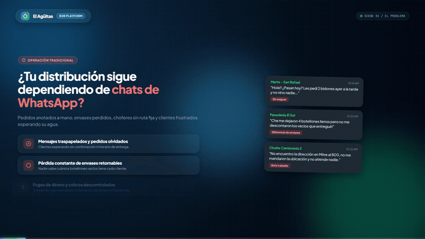

# El Agüitas

Plataforma digital para venta y reparto de agua purificada en bidones. Resuelve los pedidos perdidos por WhatsApp, organiza las rutas de los choferes con GPS y elimina las pérdidas de envases retornables.

<div align="center">
  
  <p><em>Presentación comercial en vivo disponible en: <strong>/presentacion</strong></em></p>
</div>

---

## Qué hace El Agüitas

```
  CLIENTE (Celular)              CHOFER (En la camioneta)            ADMINISTRADOR
  • Pide agua en 10 segundos     • Hoja de ruta en el celular        • Despacho de pedidos en vivo
  • Declara envases vacíos       • GPS con Google Maps en 1 toque    • Balance de bidones y stock
  • Paga con tarjeta o efectivo  • Rendición de envases en puerta    • Zonas tarifadas y choferes
```

---

## Arquitectura del Sistema

Explicación clara y directa de cómo se conecta cada parte:

```
  DISPOSITIVOS                  INFRAESTRUCTURA (Vercel)               BASE DE DATOS (Supabase)
 
 ┌───────────────┐              ┌────────────────────────┐            ┌────────────────────────┐
 │   CLIENTES    │              │   FRONTEND ESTÁTICO    │            │                        │
 │  (Mobile Web) │─────────────►│   React 19 + Vite      │            │       POSTGRESQL       │
 └───────────────┘  HTTPS       │   (Carga rápida < 1s)  │            │      EN LA NUBE        │
                                └────────────────────────┘            │                        │
 ┌───────────────┐                                                    │  • 14 Tablas SQL       │
 │   CHOFERES    │              ┌────────────────────────┐   Pooler   │  • Control de envases  │
 │  (GPS / Maps) │─────────────►│   BACKEND SERVERLESS   │  Puerto    │  • Stock de bidones    │
 └───────────────┘  API REST    │   Node.js + Express    │───────────►│  • Clientes y zonas    │
                                │   (Tokens JWT seguros) │    6543    │  • Backups automáticos │
 ┌───────────────┐              └────────────────────────┘            │                        │
 │ ADMINISTRADOR │                           ▲                        │                        │
 │ (Consola Web) │───────────────────────────┘                        │                        │
 └───────────────┘                                                    └────────────────────────┘
```

### 3 Capas Principales:
1. **Frontend (React 19 + Vite):**
   - Interfaz ultra rápida y táctil pensada para celulares.
   - PWA instalable con soporte offline y compilación nativa para Android.
2. **Backend Serverless (Node.js + Express en Vercel):**
   - Funciones serverless que solo consumen recursos cuando entra un pedido.
   - Seguridad con tokens JWT y tareas automáticas Cron a medianoche para suscripciones periódicas.
3. **Base de Datos (PostgreSQL en Supabase):**
   - 14 tablas relacionales conectadas mediante Transaction Pooler (puerto 6543 con SSL).
   - Registra cada movimiento de bidones para que ningún envase quede sin auditar.

---

## Vistas principales

### 1. Clientes: Catálogo táctil y Checkout sin fricciones
Los clientes compran directamente desde su celular, suman botellones con botones rápidos y descuentan los envases vacíos que devuelven.

| 1. Catálogo táctil | 2. Carrito reactivo | 3. Confirmación y entrega |
| :---: | :---: | :---: |
|  |  |  |

---

### 2. Choferes: Hoja de ruta móvil con GPS y WhatsApp
El chofer no usa planillas de papel. Toma los pedidos disponibles, abre la ruta en Google Maps con un toque y avisa su llegada por WhatsApp.

| Ingreso rápido | Hoja de ruta del chofer |
| :---: | :---: |
|  |  |

---

### 3. Administrador: Consola central de despacho
Control en vivo de todos los pedidos, choferes en calle, stock de agua en planta y envases prestados a los clientes.

<div align="center">
  
</div>

---

## Modelo comercial para distribuidoras

- **Puesta en marcha (Setup único):** `$120 USD`
  - Carga de catálogo con precios y logo de la distribuidora.
  - Configuración de zonas de entrega en el mapa.
  - Capacitación a choferes y personal de planta.
- **Abono mensual:** `$25 USD/mes`
  - Servidores en la nube de alta velocidad (Vercel).
  - Base de datos en PostgreSQL (Supabase) con copias de seguridad.
  - Generador automático de pedidos recurrentes y soporte técnico.
- **Retorno de inversión:** Se paga solo recuperando apenas 10 a 15 bidones al mes.

---

## Usuarios para probar el sistema

Todos los usuarios de prueba usan la contraseña **`123456`**:

| Rol | Email | Pantalla que abre |
| :--- | :--- | :--- |
| **Administrador** | `admin@agua.com` | Consola central de despacho (`/admin`) |
| **Repartidor / Chofer** | `repartidor@agua.com` | Hoja de ruta en calle (`/repartos`) |
| **Cliente** | `juan@cliente.com` | Catálogo de botellones (`/productos`) |

---

## Cómo correrlo en tu computadora

```bash
# 1. Instalar dependencias
npm install

# 2. Configurar variables (DATABASE_URL y JWT_SECRET en backend/.env)
cd backend && cp .env.example .env && cd ..

# 3. Cargar base de datos inicial
npm run db:setup

# 4. Iniciar la aplicación
npm run dev
```

- **App web:** `http://localhost:5173`
- **Presentación comercial interactiva:** `http://localhost:5173/presentacion.html`

---

## Despliegue en Vercel

1. Conectar este repositorio a **Vercel**.
2. Agregar las variables en **Settings > Environment Variables**:
   - `DATABASE_URL`: Conexión de Supabase en puerto 6543.
   - `JWT_SECRET`: Clave secreta para tokens.
   - `NODE_ENV`: `production`
3. Listo. El frontend corre en `/`, la API en `/api/*` y la presentación en `/presentacion`.
